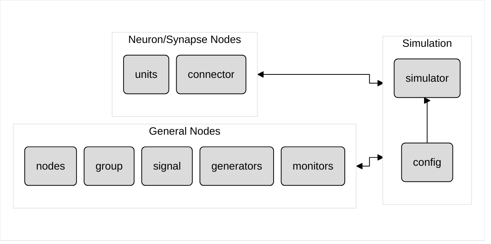

# Circuits

This library provides a neural circuits architecture builder based on PyTorch. It enables different types of circuit elements (*nodes*) to be connected into a static multilevel graph (*circuit tree*). The resulting circuit tree is a `torch.nn.Module` that can be simulated and easily integrated into an external PyTorch model.

## Organization

This library is organized into modules that implement nodes and a simulation manager:



## Usage

This example creates a half-center oscillator circuit, a flexor oscillator and an extensor neuron that inhibit each other, driven by an input signal. It simulates the circuit for 5000 ms and prints when each unit is active, then simulates a batch of 3 circuits with different drive weights.

```python
import torch

import circuits as cc


def half_center_oscillator(**kwargs) -> cc.Simulator:
  # Create a simulator (timestep in ms).
  sim = cc.Simulator(**kwargs)

  # Create an input signal, and a flexor oscillator and extensor neuron that inhibit each other.
  sim.drive = drive = cc.Signal(0.)
  sim.flx = flx = cc.Oscillator(bias=0.2)
  sim.ext = ext = cc.Basic(bias=0.8)
  flx.synapse(drive, weight=torch.nn.Parameter(torch.tensor(0.5)))
  flx.synapse(ext, weight=-0.1)
  ext.synapse(flx, weight=-0.9, delay=2)

  return sim


# Simulate 5 s, increasing the drive halfway through, which shortens the flexor's quiet phases.
sim = half_center_oscillator(timestep=10)
sim.init()
print(sim)
flx, ext = [], []
while sim.time < 5000:
  sim.drive.value[:] = 0. if sim.time < 2500 else 0.5
  sim.step()
  flx.append(sim.flx.value.item())
  ext.append(sim.ext.value.item())
print(''.join('#' if v > 0.1 else '.' for v in flx[::5]))
print(''.join('#' if v > 0.1 else '.' for v in ext[::5]))

# Simulate a batch of 3 circuits with different drive weights, by mapping a functional call of one
# simulator over batched parameters and buffers.
class Stepper(torch.nn.Module):
  def __init__(self, sim: cc.Simulator):
    super().__init__()
    self.sim = sim

  def forward(self) -> torch.Tensor:
    self.sim.step()
    return self.sim.flx.value.clone()


stepper = Stepper(half_center_oscillator(timestep=10))
stepper.sim.init()
params = {'sim.flx.weight_0': torch.tensor([0., 0.5, 1.])}  # [3]
buffers = {k: v.repeat(3, *[1] * v.ndim) for k, v in stepper.named_buffers()}  # [3, ...]
buffers['sim.drive.value'][:] = 1.  # The same drive, scaled by each circuit's weight.
step = torch.func.vmap(
  lambda p, b: torch.func.functional_call(stepper, (p, b)),
  randomness='different',  # Each circuit draws its own oscillator noise.
)
values = torch.stack([step(params, buffers) for _ in range(500)])  # [500, 3, 1]
print((values > 0.1).float().mean(dim=0).squeeze(-1))  # Flexor active fraction per circuit.
```

The flexor's activity alternates with the extensor's, and its quiet phases shorten when the drive increases:

```
...............##########...............##########.........#########.........#########.........#####
################....#####################....###############..################..################..##
tensor([0.4000, 0.5740, 0.9980])
```

Each simulator state tensor has shape `[1]`, so a batch of circuits is simulated by mapping one simulator over batched parameters and buffers with `torch.func`, as above. Units' noise is drawn from the global torch random number generator: seed it (`torch.manual_seed`) for reproducible simulations.

## Testing

Each module's tests are in the `_test.py` file next to it. From the repository root:

```bash
pytest libs/circuits
```
