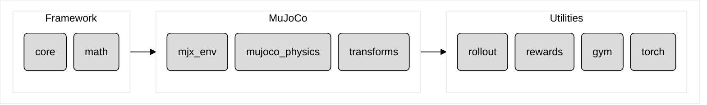

# Composer

This library builds reinforcement learning environments from composable parts, simulated with MuJoCo and MJX. A *task* combines *entities* (such as a body and an arena) into a tree; each entity contributes its MuJoCo model, actions, and observations, and a stack of *transforms* (such as action clipping or muscle controllers) modifies them. The result is a functional, vectorized JAX environment that runs many worlds at once on the 'jax' and 'warp' MJX backends or on native MuJoCo.

## Organization

This library is organized into modules that implement the environment framework, the MuJoCo environment and its transforms, and utilities for running environments:



- `core`: Spaces (`Box`, `Dict`), the functional `Env` interface and its `Step`, and the entity tree (`Entity`, `Transform`) with the local state of its nodes.
- `math`: Rescaling, interpolation, and rotation conversions for JAX arrays.
- `mjx_env`: The MuJoCo environment (`MjxEnv`) of a task (`MjxTask`) and its child entities (`MjxEntity`), with its physics backends, rendering, and contact forces.
- `mujoco_physics`: Native C MuJoCo physics for MJX data, used by the 'mujoco' backend.
- `transforms`: Transforms for clipping, delaying, rescaling, and remapping actions and observations, and joint controllers (PD and spring-muscle).
- `utils.rollout`: Rolling out policies with recording and rendering, and saving and replaying rollouts.
- `utils.rewards`: Bounded, smooth reward curves.
- `utils.gym`: A Gymnasium `VectorEnv` adapter with Torch tensors, and space conversions.
- `utils.torch`: Conversion between Torch tensors and JAX arrays, and parameter packing for Torch modules.

## Usage

This example builds a task that rewards pushing a box along x, then steps and renders 4 worlds of it.

```python
import collections

import jax
import jax.numpy as jnp
import mujoco as mj

import composer as cx
import composer.transforms as cxt
import composer.utils.rollout as cxr

# Optional: For rendering, this example displays videos in a Jupyter notebook.
import mediapy


# A body entity: a box on a free joint, with a motor that pushes it along x.
class Box(cx.MjxEntity):

  def __init__(self):
    mj_spec = mj.MjSpec.from_string("""
      <mujoco>
        <worldbody>
          <body name="box" pos="0 0 0.05">
            <freejoint name="slide"/>
            <geom type="box" size="0.05 0.05 0.05" mass="1" rgba="0.8 0.3 0.3 1"/>
          </body>
        </worldbody>
        <actuator><motor name="push" joint="slide" gear="20 0 0 0 0 0"/></actuator>
      </mujoco>
    """)
    super().__init__(mj_spec=mj_spec, transforms=[cxt.ClipAction()])

  def action_space(self, state):
    return cx.Dict({'push': cx.Box(-1.0, 1.0, shape=(1,))})

  def action(self, state, action):
    return state.replace(mjx_data=state.mjx_data.replace(ctrl=action['push']))

  def observation_space(self, state):
    return cx.Dict({'x': cx.Box(-jnp.inf, jnp.inf, shape=(1,))})

  def observation(self, state):
    return collections.OrderedDict(x=state.mjx_data.qpos[:1]), state


# The task: a floor and a camera, with the box attached as a child entity. It rewards the box's
# velocity along x, and starts each episode with the box at a random x.
class PushBox(cx.MjxTask):

  def __init__(self):
    mj_spec = mj.MjSpec.from_string("""
      <mujoco>
        <worldbody>
          <light pos="0 0 2"/>
          <geom type="plane" size="2 2 0.1"/>
          <camera name="side" pos="0 -1.5 0.3" xyaxes="1 0 0 0 0 1"/>
        </worldbody>
      </mujoco>
    """)
    box = Box()
    mj_spec.attach(box.mj_spec, 'box/', frame=mj_spec.worldbody.add_frame())
    super().__init__(
      children={'box': box},
      mj_spec=mj_spec,
      env_timestep=0.02,
      sim_timestep=0.002,
    )

  def on_reset(self, state, subtask):
    x = jax.random.uniform(state.rng, (), minval=-0.5, maxval=0.0)
    return state.replace(mjx_data=state.mjx_data.replace(qpos=state.mjx_data.qpos.at[0].set(x)))

  def get_rewards(self, state, terminated):
    return {'velocity': (jnp.ones(()), state.mjx_data.qvel[0])}


# Create the environment. The 'jax' and 'warp' backends simulate with MJX on the accelerator; the
# 'mujoco' backend runs native MuJoCo on the CPU.
env = cx.MjxEnv(PushBox(), truncate=100, backend='mujoco')

# Initialize 4 worlds. A child's keys are prefixed with its name: 'box/push' and 'box/x', each
# [4, 1] across the worlds.
rng = jax.random.split(jax.random.key(0), 4)
state = env.initialize(rng)
print(env.action_space(state))
print(env.observation_space(state))

# Push all boxes for 10 steps. Actions beyond the bounds are clipped to 1 by `ClipAction`.
step = env.reset(state, rng)
for _ in range(10):
  step = env.step(step.state, {'box/push': jnp.full((4, 1), 5.0)})
print(step.observation['box/x'], step.reward)

# Roll out actions sampled from the action space for 2 s, rendering the first world.
rollout = cxr.rollout_from_policy(
  env, policy='random', duration=2.0, vectorize=4, render={'camera': 'side'},
)
mediapy.show_video(rollout.render, fps=rollout.render_rate)
```

Rendering uses MuJoCo's OpenGL renderer, so it needs a `MUJOCO_GL` backend that works on the machine (e.g. `egl` with a GPU, or `osmesa` without one).

## Testing

Each module's tests are in the `_test.py` file next to it. From the repository root:

```bash
pytest libs/composer
```
