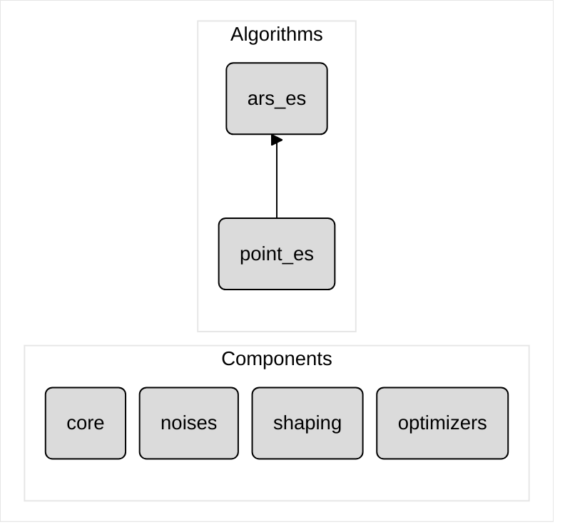

# Evolution2

This library provides evolutionary algorithms for gradient-free optimization in PyTorch. An *algorithm* evolves parameter vectors to maximize the score of an *objective*, and a *trainer* runs the algorithm for many epochs, with testing, logging, checkpointing, and exact resumption of interrupted runs. Each generation's population is scored as one batch, so an objective can evaluate it in parallel (e.g. on a GPU).

## Organization

This library is organized into modules that implement the trainer, algorithmic components, and algorithms built using them:



- `core`: The `Objective` and `Algorithm` interfaces, and the `Trainer`.
- `noises`: Seeded noise blocks, and `multiseed` to combine seeds (e.g. a run's seed and an epoch) into one.
- `shaping`: Transforms of a population's scores (e.g. z-scores, ranks).
- `optimizers`: Optimizers that turn estimated gradients into parameter updates (SGD, SGD with momentum, Adam).
- `algos.point_es`: `PointEvolutionStrategy`, which evolves a single parent with mirrored mutations and an estimated gradient.
- `algos.ars_es`: Augmented Random Search, a configuration of `PointEvolutionStrategy`.

## Usage

This example trains a 10-dimensional parameter vector to reach a target with Augmented Random Search.

```python
import torch

import evolution2


# The objective: maximize the negative squared distance of each parameter vector to a target.
class Quadratic(evolution2.Objective):

  def __init__(self, size: int = 10):
    self.target = torch.linspace(-1, 1, size)

  def get_initial_params(self, seeds):
    return torch.zeros(1, len(self.target))  # One parent parameter vector.

  def get_score(self, params, seeds, *, mode, epoch=0, stats, files):
    distance = ((params - self.target) ** 2).sum(dim=1)  # [size]
    stats['distance'] = distance  # Logged as columns of train.csv or test.csv.
    return -distance


# Train with ARS: 64 children per epoch in mirrored pairs, of which the best 16 pairs estimate the
# gradient.
algorithm = evolution2.algos.AugmentedRandomSearchEvolutionStrategy(
  population_size=64,
  top_best=16,
  test_size=4,
  mutation_scale=0.05,
  gradient_scale=1.0,
)
trainer = evolution2.Trainer(
  algorithm,
  Quadratic(),
  epochs=200,
  test_freq=10,
  save_freq=50,
  logger='./outputs/quadratic',
)
trainer.initialize()
params = trainer.run()  # [1, 10]
print(params)
```

The test score rises from about -4 at epoch 0 to about -0.001 at epoch 200. The trainer writes to its log directory:

- `train.csv`, `test.csv`: One row per train epoch and per test epoch. A tensor stat is summarized in columns of its mean, std, min, max, and size, e.g. `test/scores/raw/mean` or `test/distance/mean`.
- `params/<epoch>.pkl`: The parameters at each save epoch (every `save_freq` epochs, and the first and last).
- `algorithm/<epoch>.pkl`: The algorithm's state at each save epoch, to resume from.
- `train/<name>/<epoch>.pkl`, `test/<name>/<epoch>.pkl`: The algorithm's and objective's `files` at each save epoch.

Running the trainer again in the same log directory resumes from the newest saved state (`resume='auto'`), so a run that is stopped and restarted (e.g. a preempted job) continues where it stopped. `resume_from` resumes from another run's log directory instead. Resuming is exact: each epoch's mutations and objective seeds derive from the trainer's seed and the epoch, so the resumed epochs are recomputed identically, as long as the objective keeps no state across epochs.

## Testing

Each module's tests are in the `_test.py` file next to it. From the repository root:

```bash
pytest libs/evolution2
```
